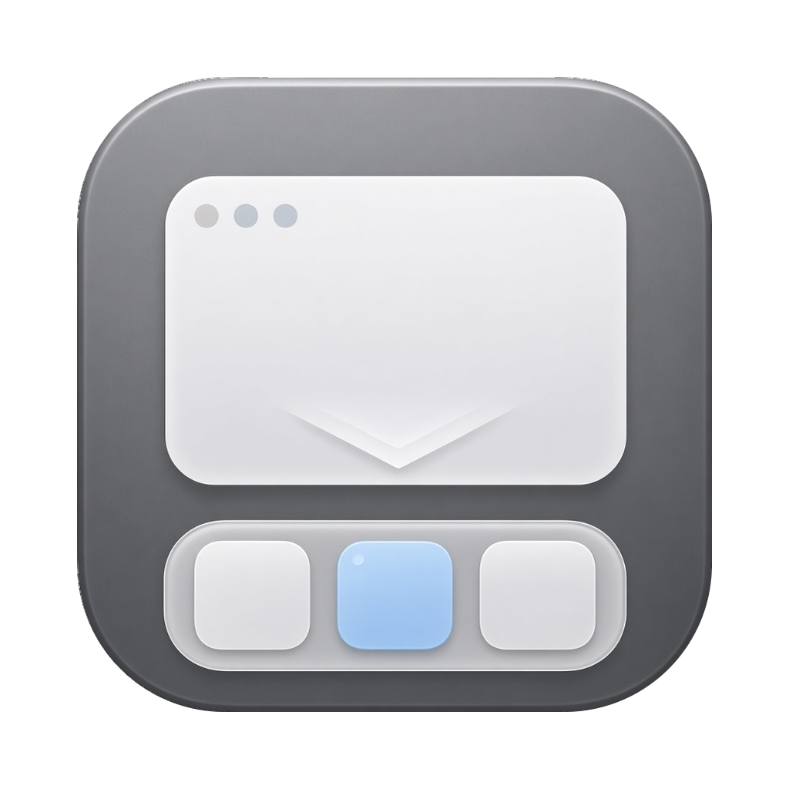

<p align="center">
  <b>English</b> · <a href="README.zh-CN.md">简体中文</a>
</p>

<p align="center">
  
</p>

<h1 align="center">TapDock</h1>

<p align="center">Click the Dock icon of the frontmost app to tuck it away. Click again to bring it back.</p>

<p align="center">macOS 13 or later · menu bar · MIT</p>

TapDock is a small menu-bar utility. It watches for a click on the Dock icon of the app already in front, then hides that app or minimizes its windows. The next click is left to the Dock, which shows or restores the app.

## Why TapDock

The Dock does not tuck away the frontmost app when you click its icon. TapDock adds that gesture and stays out of the way:

- **Ultra-lightweight.** Pure Swift and Apple frameworks (`Cocoa`, `SwiftUI`, `ApplicationServices`, `ServiceManagement`). No bundled updater, no Sparkle, no network code.
- **Trackpad friendly.** Tap to Click plus three-finger drag can synthesize a click on the icon of an app that just became active. TapDock waits that moment out instead of hiding the app you just switched to.
- **Native panel.** A transient menu-bar popover, system type, and the menu-bar icon you already have — drawn as a template so it stays crisp in Light and Dark Mode.

## Features

- **Dock click to tuck away.** Click the icon of the frontmost app to hide it (default, in the spirit of ⌘H) or minimize its windows.
- **Show and restore.** A click on a hidden app, or on an app whose windows are already minimized, is handed back to the Dock so the app can return.
- **Active / paused.** The menu-bar switch stops Dock actions without quitting.
- **Launch at Login.** `SMAppService.mainApp` on macOS 13 and later. Moving the app to `/Applications` makes approval straightforward.
- **Accessibility, explained in the panel.** The banner appears when permission is missing and offers **Open Settings**. A quiet checkmark replaces it once permission is on. The state refreshes while the panel is open.

## Trackpad guards

Three checks keep a sloppy trackpad click from hiding the wrong app:

| Guard | Window | What it stops |
| --- | --- | --- |
| App-switch cooldown | 0.40s after a new app activates | The extra click at the end of a three-finger drag or an app switch |
| Dock-action debounce | 0.45s after TapDock accepts a click | A second event firing the action twice |
| Repeated click | `clickCount` greater than 1 | Double-clicks |

A real re-click waits **0.15s**, then runs only if that app is still frontmost and no newer activation has been recorded. Switching apps, or clicking a Dock icon to bring an app back, changes that stamp and the action is dropped.

## Accessibility

TapDock uses the Accessibility API to recognize `AXApplicationDockItem` clicks and to hide or minimize windows. It does not record the screen or read document contents.

On first launch, macOS may show its permission prompt. You can also open the panel and choose **Open Settings**, which jumps to **System Settings → Privacy & Security → Accessibility**. Enable **TapDock** there.

An ad-hoc signature changes every rebuild. If Dock clicks stop working after you build again, toggle TapDock off and on in that Accessibility list.

## Build

Requires macOS 13 or later and Xcode Command Line Tools (`swiftc`, `codesign`, `lipo`). Xcode itself is not required.

```bash
./scripts/build.sh
open dist/TapDock.app
```

That produces an arm64 `dist/TapDock.app`, ad-hoc signed with `codesign --force --deep --sign -`.

```bash
./scripts/build.sh --universal          # arm64 + x86_64
./scripts/build.sh --zip                # dist/TapDock-0.1.0-arm64.zip
./scripts/build.sh --universal --zip    # dist/TapDock-0.1.0-universal.zip
```

`--release` is the same as `--zip`.

Gatekeeper may warn the first time you open an ad-hoc build. Right-click the app, choose **Open**, and confirm. For Launch at Login, copy `TapDock.app` to `/Applications` before turning the switch on.

To see the Dock-click decisions in Console:

```bash
log stream --predicate 'subsystem == "io.github.rijian-song.TapDock"' --level info
```

## Layout

```
Sources/TapDock/     Swift sources
Resources/           AppIcon.icns, menu-bar template icons, README artwork
scripts/build.sh     arm64 / universal / zip
Info.plist           bundle id io.github.rijian-song.TapDock
```

## Attribution

TapDock is an independent, simplified derivative of [WinDock](https://github.com/Songhoonma/WinDock) by L2M Group Ltd., used under the MIT License.

Copyright (c) 2026 Rijian Song  
Copyright (c) 2026 L2M Group Ltd.

See [LICENSE](LICENSE).
