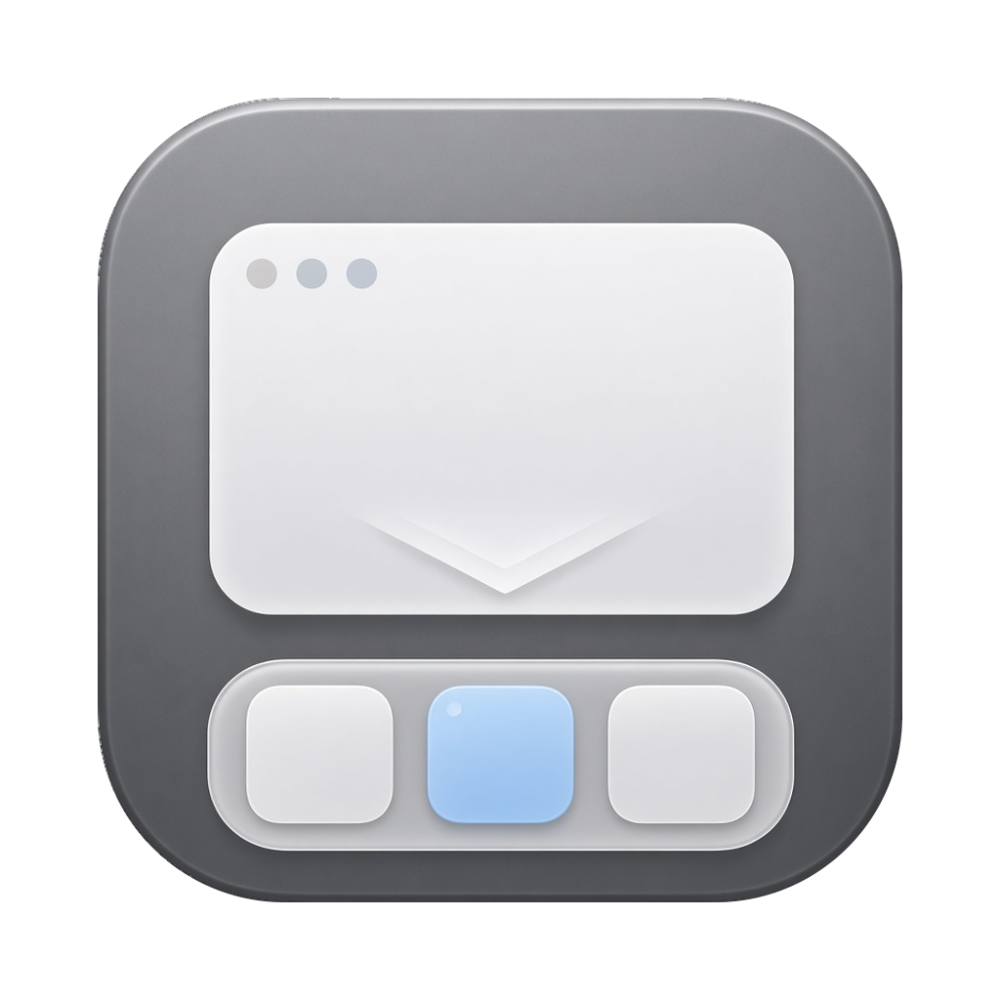

<p align="center">
  <a href="README.md">English</a> · <b>简体中文</b>
</p>

<p align="center">
  
</p>

<h1 align="center">TapDock</h1>

<p align="center">点击当前最前应用的 Dock 图标，把它收起来。再点一次，它就会回来。</p>

<p align="center">macOS 13 及以上 · 菜单栏 · MIT</p>

TapDock 是一个很小的菜单栏工具。它留意你对「已经在最前面的应用」的 Dock 图标的点击，然后隐藏该应用，或把它的窗口最小化。下一次点击交给 Dock 自己处理，由系统把应用重新显示或还原。

## 为什么做 TapDock

macOS 的程序坞（Dock）在你点击当前应用图标时，并不会把它收起。TapDock 补上这个动作，同时尽量不添负担：

- **足够轻。** 只用 Swift 和系统框架（`Cocoa`、`SwiftUI`、`ApplicationServices`、`ServiceManagement`）。没有内置更新器，没有 Sparkle，也没有联网代码。
- **照顾触控板。** 打开「轻点来点按」和「三指拖移」时，切换应用的末尾常常会多出一个点击，正好落在刚被激活的图标上。TapDock 会等过这一小段时间，避免把你刚切到的应用立刻藏起来。
- **系统原生的面板。** 临时的菜单栏弹出面板、系统字体，以及会随浅色 / 深色模式变化的模板图标。

## 功能

- **点击 Dock 图标收起应用。** 点击最前应用的图标即可隐藏（默认，接近 ⌘H），或最小化它的窗口。
- **显示与还原。** 若应用已隐藏，或窗口已经全部最小化，这次点击会留给 Dock，让应用回来。
- **启用 / 暂停。** 菜单栏里的开关可以停掉 Dock 动作，不必退出。
- **登录时打开。** 在 macOS 13 及以上使用 `SMAppService.mainApp`。把应用放到「应用程序」文件夹后，系统批准会更顺利。
- **辅助功能状态写在面板里。** 尚未授权时会出现说明和 **打开设置**。授权之后换成一行安静的对勾。面板打开期间会持续刷新状态。

## 触控板防误触

三道检查用来挡住不该生效的点击：

| 检查 | 时间窗 | 挡住什么 |
| --- | --- | --- |
| 应用切换冷却 | 新应用激活后的 0.40 秒 | 三指拖移或切换应用结束时多出来的点击 |
| Dock 动作去抖 | TapDock 接受一次点击后的 0.45 秒 | 同一次手势触发两次动作 |
| 重复点击 | `clickCount` 大于 1 | 双击 |

真正的再次点击会先等待 **0.15 秒**，只有该应用仍在最前、且这段时间里没有更新的激活记录时才执行。切换到别的应用，或点击 Dock 把应用唤回，都会改掉这个时间戳，动作随之取消。

## 辅助功能

TapDock 用辅助功能 API 识别 `AXApplicationDockItem` 点击，并隐藏或最小化窗口。它不录制屏幕，也不读取文稿内容。

首次打开时，macOS 可能会弹出授权提示。也可以在面板里点 **打开设置**，前往 **系统设置 → 隐私与安全性 → 辅助功能**，打开 **TapDock**。

临时签名在每次重新构建后都会变化。如果构建之后 Dock 点击没有反应，在辅助功能列表里把 TapDock 关掉再打开一次。

## 构建

需要 macOS 13 或更高版本，以及 Xcode 命令行工具（`swiftc`、`codesign`、`lipo`）。不需要打开 Xcode。

```bash
./scripts/build.sh
open dist/TapDock.app
```

默认生成 arm64 的 `dist/TapDock.app`，并用 `codesign --force --deep --sign -` 做临时签名。

```bash
./scripts/build.sh --universal          # arm64 + x86_64
./scripts/build.sh --zip                # dist/TapDock-0.1.0-arm64.zip
./scripts/build.sh --universal --zip    # dist/TapDock-0.1.0-universal.zip
```

`--release` 与 `--zip` 相同。

临时签名的应用第一次打开时，Gatekeeper 可能会提示。在 Finder 里右键点按应用，选择 **打开** 并确认。若要使用「登录时打开」，请先把 `TapDock.app` 复制到「应用程序」文件夹，再打开开关。

在控制台查看 Dock 点击的判断：

```bash
log stream --predicate 'subsystem == "io.github.rijian-song.TapDock"' --level info
```

## 目录

```
Sources/TapDock/     Swift 源文件
Resources/           AppIcon.icns、菜单栏模板图标、README 用图
scripts/build.sh     arm64 / 通用二进制 / zip
Info.plist           套件标识 io.github.rijian-song.TapDock
```

## 署名

TapDock 是 [WinDock](https://github.com/Songhoonma/WinDock)（L2M Group Ltd.）的独立、精简衍生作品，依 MIT 许可证使用。

Copyright (c) 2026 Rijian Song  
Copyright (c) 2026 L2M Group Ltd.

详见 [LICENSE](LICENSE)。
